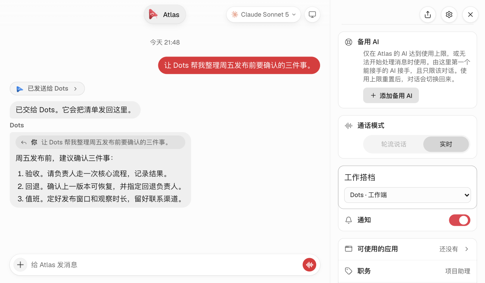

# 将 Dots 接入 MausBot 工作协作

## 用户入口和交付目标

Atlas 代表用户正在聊天的主 bot，Dots 是接活的工作端。管理员将独立的 Dots 本地服务接到 MausBot 后，系统为该收件箱登记一个私有的 Dots bot，沿用已有「工作搭档」选择器。用户在 Atlas 的私聊点顶部的 **Atlas → 右上角齿轮「机器人设置」→ 工作搭档 → Dots · 工作端**。选择即保存。日常使用同一个输入框，例如「让 Dots 帮我整理周五发布前要确认的三件事」。Atlas 也可以根据分工自行委派。

聊天里会出现「已发送给 Dots」。用户可以继续跟 Atlas 聊其他事，也可以点这条记录查看 Dots 的工作线程。Dots 完成后在 Atlas 的原会话署名回复，引用原请求，文件随结果交付。平时无需打开 Dots 私聊。侧栏中 Dots 的固定私聊用于独立来信及直接交谈。

图为隔离实例中的中文 Web 实拍。通过真实选择器绑定、从 Atlas 的输入框发起委派，工作端由脚本模拟。已核对原会话只出现一份带 Dots 作者及原消息引用的交付，点击「已发送给 Dots」可以看到对应的工作线程。真实 Dot 从 MausBot 接单仍待实施。[工作搭档验收](../verification/async-bot-partner.md)

## 绑定范围

同一个远端 Dot 持有同一份上下文。首版建议每个收件箱绑定一个所有者、一个 Dots bot、一个可派活的主 bot 和该所有者指定的一段主 bot 私聊。工作线程分别记录任务和结果。直接私聊和委派内容仍可能被远端 Dot 一起记住，应在选中 Dots 时说明这一点。需要独立上下文的项目配置另一个具有独立上下文的远端 Dot 与收件箱。

现有工作搭档关系按 bot 保存。对 Dots，保存绑定时另存当前来源私聊，在不同会话或不可达 bot 的设置中说明适用范围。服务端在构造搭档候选、派发工具调用、执行和交付时核验所有者、绑定和线程权限。普通队友派发、群聊、API、定时和嵌套调用同样经过入口检查。首版对 Dots 开放已授权的私聊工作委派和所有者直接私聊。解绑影响后续派发，在途任务沿用受理时的来源，并在送达前复核权限。更换绑定或编辑本地分支不会重置远端上下文。[绑定接口](../../server/routes/work-partner.ts) · [工作委派识别和交付](../../server/host/work-partner.ts)

## 执行、关联与双向收件

| 位置 | 实施约定 |
| --- | --- |
| MausBot 协作运行时 | Atlas 照常通过 `coordinate_bots` 派给 Dots。运行时创建既有父子委派，提前保存来源 bot、线程、分支的原消息 ID、Dots 工作线程及子委派 ID。Atlas 收到受理回执即可继续。 |
| Dots 驱动 | 注册独立的 `dots` ProviderDriver，执行被分配的工作。传给本地服务的是实际委派正文和获准交接的附件。直接私聊则读取已落盘的用户原文和本次附件。通用提示词中拼入的记忆、历史、机上路径和工具信息留在 MausBot。 |
| Dots 本地服务 | 继续负责转发、收件、归档和幂等发件，可供其他宿主复用。MausBot 在服务端读取回环地址及专用 token 文件，凭据从前端、配置导出和子进程环境排除。正式接管由管理员显式执行，401 暂停该绑定。界面分别报告本地服务连通、宿主授权和远端订阅状态。 |
| MausBot 收件器 | 每个绑定只有一个后台消费者，长轮询 `GET /v1/events?wait=25`。浏览器关闭时照常处理，MausBot 停机期间由本地服务保留事件。接收器恢复子任务，沿用工作搭档运行时将结果投回来源。 |

[驱动注册](../../server/drivers/builtIn.ts) · [上下文构造](../../server/turn-context.ts) · [协作运行时](../../server/runtime-coordinator.ts) · [Dots 本地宿主 API](../../../dots-bridge/local-service/README.md)

1. **发件。** 先持久化操作 ID、触发来源（委派或直接私聊）、归属与有序附件引用。委派以子委派 ID 认领同一次操作，直接聊天以发送操作及用户消息 ID 识别。持久化附件上传结果，以稳定的 `idempotency_key` 和 `correlation_id` 提交 `POST /v1/messages`。202 表示已排队，保存返回的本地消息 ID 和随后获得的远端 request_id。丢失响应时原样重放。上传成功后若来不及保存文件 ID，可能留下额外暂存文件。
2. **进度与结果。** progress 更新对应的工作记录。reply 完成相应子任务，由现有工作搭档交付逻辑以 Dots 身份回原消息所在分支，直答引起的额外 Atlas 回合为零。直接私聊回执写入发起该请求的私聊。failed、expired、cancel 保留实际终态。回执早于 202 到达时按 correlation_id 找到意图，只有 message_id 的事件可用消息查询接口核对。needs_review 保留待核对状态，避免以新键重复派活。
3. **独立推送。** 无请求关联的 push 只进入所有者的 Dots 私聊并产生未读。多个在途任务并存也不按当前窗口或最近任务猜归属。旧宿主遗留或来源失效的回执进入受保护的待处理记录。收到来信不会触发新的委派。
4. **可靠交付。** 以绑定和事件 ID 去重，在同一事务记录事件和可重放的交付工作，提交后才确认连续 sequence。后台消费者与活跃驱动共享同一份记录。跨聊天库和运行时库按子委派 ID 重放结算与投递，重启后检查已提交的结果。附件稍后就绪时补到原交付，不额外生成一条答复。
5. **停止。** 停止原委派时先采用协作体系的取消语义。已送达远端的任务可能继续执行，迟到回执归档，原会话不再交付或唤醒 Atlas。直接私聊的「停止等待」保留原消息关联，可在该私聊展示迟到回复。若发件排队后尚未投递，本地服务目前也没有按宿主请求撤回发件的接口。
6. **追问和转述。** 首版交付进度、署名直答和附件。Dots 当前协议提供 progress、reply、push、cancel。自然语言中的问句可作为署名回复展示。后续若需要在卡内回答并恢复原工作、或由 Dots 主动要求 Atlas 转述，须扩展有类型的请求事件、问题 ID、关联和去重，再接 MausBot 的问题卡及转述入口。普通文字保持原义。[已有工作搭档交付约定](../finished_plans/async-bot-partner.md)

## 附件

委派只发送 Atlas 显式交接且有权读取的文件。直接私聊按用户选择读取原始字节，保留文件顺序，支持纯附件、最多四个文件、单个 20 MiB。发送入口保留原始附件描述，避免将已转码的视频帧作为原件发送。入站按本地附件 ID 记录引用和 ready、retry、unavailable 状态。工作结果复用现有交付附件及来源消息鉴权，直接私聊下载由 MausBot 服务端验证所有者与消息归属后流式取回。[附件存储](../../server/attachments.ts) · [协作交接文件](../../server/host/handoff-files.ts)

## 实施顺序与验收

| 阶段 | 通过条件 |
| --- | --- |
| 1. 工作搭档文字闭环 | 登记 Dots 工作端，绑定 Atlas。隔离实例从真实 UI 派活，Dot 回传进度和最终答复。Atlas 工作期间可继续聊天，原分支只有一份 Dots 署名结果，Atlas 无额外模型回合。另一个所有者、未绑定的线程和群聊均无法派给该端点。 |
| 2. 双向通信与恢复 | 两个委派交错回执并穿插独立推送，分别核对两个原请求与 Dots 私聊。覆盖 202 丢失、确认丢失、宿主重启、订阅撤销、解绑、换分支、权限撤销、取消后迟到及直接私聊。独立推送和旧回执不能完成任何在途委派。 |
| 3. 文件与正式接管 | 核验纯附件、正文加附件、归档延迟、缺失原件和跨线程下载授权。桌面和窄屏核对交付与未读。用独立验证绑定完成真实 Dot 与附件往返，再由管理员接管正式宿主。 |

开发与故障回放使用隔离的 MausBot home、临时 Dots 数据目录和模拟上游。正式 token 接管会吊销旧凭据，测试不能推进正式收件箱的 ACK。[隔离验收规范](../verification/README.md)
